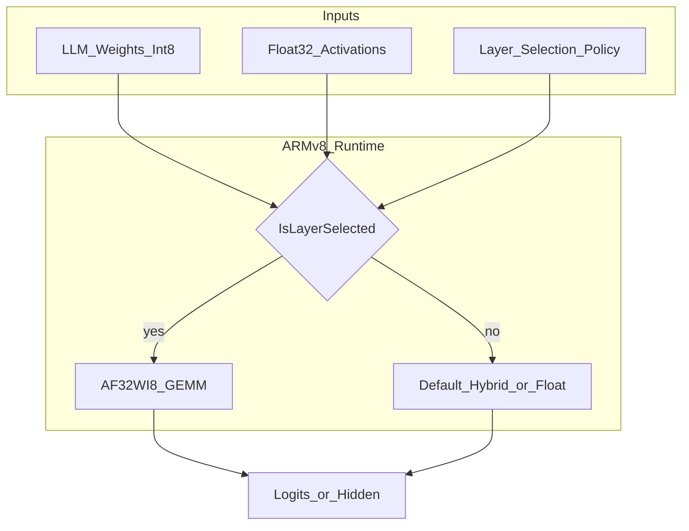
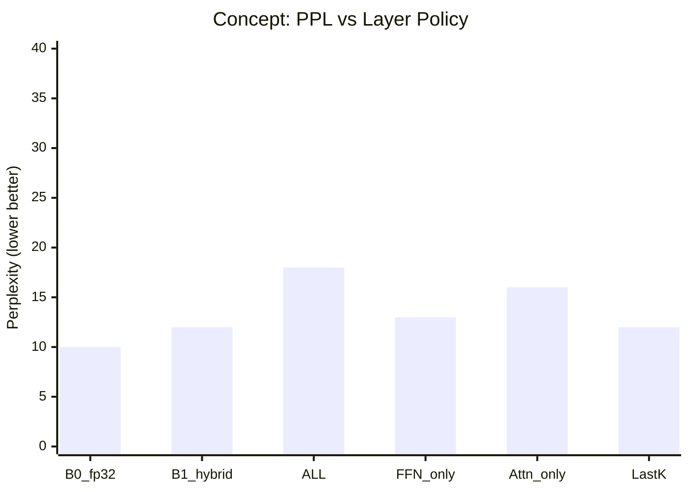
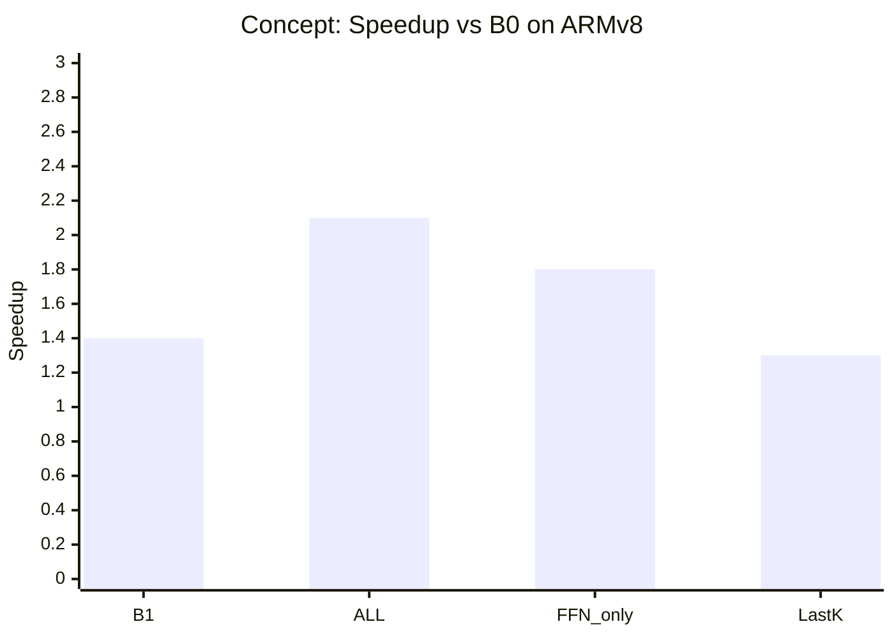
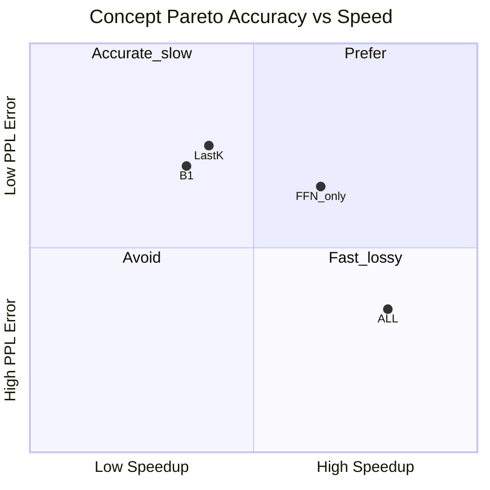

# پلن ارزیابی روش AF32WI8 برای لایههای Dense/FC در LLMها

## هدف
سنجش اینکه ضرب هیبرید **فعالسازی float32 × وزن int8 (AF32WI8)** روی ARMv8، وقتی فقط روی **لایههای انتخابشده**ی یک LLM اعمال شود، از نظر **دقت**، **پایداری خطا**، و **کارایی** نسبت به baselineها چقدر سود/ضرر دارد.

این پلن **جایگزین تست واحد پیادهسازی نیست**؛ روی صحت کابلکشی (`LowPrecisionFC_Layers`) تکیه میکند و روی **کیفیت روش برای inferenceی LLM** تمرکز دارد.

## فرضها و محدوده
- سختافزار هدف: CPU ARMv8 (aarch64 + NEON)؛ اندازهگیری با دستگاه واقعی یا qemu فقط برای صحت، نه برای latency نهایی.
- اپراتور هدف فاز ۱: FullyConnected / Linear / projections داخل Transformer (نه Conv).
- کنترل لایه: `LowPrecisionFC=AF32WI8` + `LowPrecisionFC_Layers=ALL|indices|names`.
- مدلهای پیشنهادی (کوچک → متوسط، قابل اجرا روی edge):
  - TinyLlama-1.1B یا Qwen2-0.5B / SmolLM-135M (اولویت با کوچکترین قابل تبدیل به TFLite/ExecuTorch یا مسیر FC استخراجشده)
  - حداقل یک مدل فقط-MLP مصنوعی با چند Linear پشتسرهم برای ایزوله کردن خطای matmul

اگر تبدیل کامل LLM به TFLite سنگین شد، مسیر موازی: استخراج GEMMهای واقعی لایه (شکل M×K×N و وزن int8) و ارزیابی با harness FullPack + replay روی توالی لایهها.

## Baselineها
| ID | توضیح |
|----|--------|
| B0 | float32 × float32 (مرجع دقت) |
| B1 | hybrid رسمی TFLite (وزن int8، فعالسازی quant دینامیک) بدون FullPack |
| B2 | AF32WI8 روی **همه** FCهای قابل اعمال (`Layers=ALL`) |
| B3 | AF32WI8 فقط روی زیرمجموعهها (سناریوهای لایه) |

## سناریوهای تست

### S1 — صحت هسته (kernel unit, نه مدل)
- ورودی: ماتریسهای تصادفی و تکههای واقعی وزن LLM با اشکال رایج FFN (`K,N ∈ {512,1024,2048,4096}`، `M ∈ {1,4,8,16,64}`).
- هدف: خطای مطلق/نسبی matmul قبل از ورود به مدل کامل.

### S2 — حساسیت عمق (error accumulation)
- یک برج از `L` لایه Linear پشتسرهم با وزنهای ثابت (یا وزن واقعی متوالی FFN).
- مقایسه خروجی لایهٔ آخر در برابر B0 وقتی AF32WI8 روی همه / فقط نیمهٔ اول / فقط نیمهٔ آخر اعمال شود.

### S3 — انتخاب لایه در Transformer (اصلی برای LLM)
برای هر بلوک attention+FFN، گروهها:
- فقط Q/K/V projections
- فقط output projection
- فقط FFN up/gate
- فقط FFN down
- فقط لایههای آخر شبکه (last-k blocks)
- فقط لایههای اول (first-k blocks)
- الگوی شطرنجی (زوج/فرد)

### S4 — اندازهٔ batch / طول context
- `M = 1` (decode تکتوکنی) در برابر `M = 4..64` (prefill کوچک)
- آیا AF32WI8 روی decode (GEMVمانند) بهصرفه است یا فقط روی prefill؟

### S5 — پایداری عددی روی داده واقعی
- فعالسازیهای گرفتهشده از forward واقعی مدل (نه uniform تصادفی)
- توزیعهای نزدیک صفر / outlier بعد از RMSNorm/SiLU

### S6 — کارایی روی دستگاه ARMv8
- latency هر لایه، end-to-end tokens/s، و سربار packing
- مقایسه B0 / B1 / B2 / بهترین B3

## متریکها

### دقت عددی (matmul / تنسور)
| متریک | کاربرد |
|--------|--------|
| MAE / MSE / RMSE | خطای عنصر به عنصر نسبت به B0 |
| MaxAbs / MaxRel | بدترین مورد |
| ULP / mean ULP | خطای ممیزشناور (سازگار با آزمایشهای قبلی F32INT8) |
| Cosine similarity | شباهت جهت بردار خروجی لایه |
| KL(logits ∥ B0) / Δtop-1 | فاصله توزیع توکن بعدی |

### کیفیت LLM
| متریک | کاربرد |
|--------|--------|
| Perplexity (PPL) روی WikiText-2 / C4 slice | کیفیت زبان مدل |
| Accuracy تکوظیفهای سبک | مثلاً Lambada یا چند سؤال چندگزینهای کوتاه |
| Match@1 next-token روی ۱۰۰–۱۰۰۰ prompt ثابت | حساسیت عملی decode |
| Exact-match خروجی کوتاه (greedy) | رگرسیون رفتاری |

### کارایی
| متریک | کاربرد |
|--------|--------|
| Latency p50/p95 لایه و e2e | تجربه واقعی |
| Tokens/s (prefill و decode جدا) | throughput |
| Speedup vs B0 و vs B1 | سود روش |
| درصد زمان packing / GEMM | گلوگاه |

### انتخاب لایه
| متریک | کاربرد |
|--------|--------|
| Pareto: ΔPPL در برابر Speedup | کدام subset لایه بهتر است |
| Sensitivity score هر گروه لایه | `|ΔPPL| / درصد FLOPs جایگزینشده` |

## طرح آزمایش (اجرایی)
1. استخراج فهرست FCها و نام/ایندکس پایدار بعد از تبدیل.
2. ساخت جدول سناریو × متریک (حداقل S1–S3 و S6 اجباری؛ S4–S5 اگر زمان بود).
3. برای هر سناریو ۳ seed وزن/داده (یا ۳ slice متن) → میانگین و انحراف.
4. ذخیره خام: CSV/JSON در `FullPack/notebooks/eval_results/` یا مسیر گزارش پایاننامه.
5. تولید نمودارهای مفهومی زیر + جدول خلاصه ۱ صفحهای.

## خروجی مستند مورد انتظار
- جدول مقایسه baselineها (PPL، MaxAbs لایه بحرانی، tokens/s)
- جدول رتبهبندی استراتژیهای `LowPrecisionFC_Layers`
- ۳–۵ نمودار مفهومی (در گزارش؛ داده از CSV):

> اعداد نمودارها **مفهومی**اند تا ساختار گزارش روشن شود؛ بعد از اجرای واقعی با دادهٔ آزمایش جایگزین میشوند.

## معیار موفقیت (پیشنهادی)
- S1: MaxAbs در محدوده تلورانس شناختهشدهٔ AF32WI8 روی اشکال پشتیبانی شده.
- S3: حداقل یک سیاست لایه (مثلاً FFN-only یا Last-k) با:
  - افت PPL نسبت به B1 کمتر از آستانه توافقی (مثلاً ≤ ۲–۵٪ نسبی روی slice ثابت)، **و**
  - Speedup ملموس نسبت به B0 روی دستگاه ARMv8.
- هیچ سیاستی نباید از نظر Match@1 next-token نسبت به B0 روی مجموعهٔ رگرسیون ثابت «فروپاشی» کند (آستانه صفر یا نزدیک صفر اختلاف غیرمجاز روی smoke set).

## ترتیب کار پیشنهادی
1. Replay ماتریس واقعی یک بلوک FFN (سریع، ایزوله) → S1/S2
2. سیاستهای لایه روی مدل کوچک → S3 + متریکهای LLM سبک
3. بنچمارک دستگاه → S6 و نمودار Pareto
4. نوشتن بخش نتایج در گزارش/نوتبوک ارزیابی

## خارج از اسکوپ این فاز ارزیابی
- GPU / x86 kernel
- Conv2D
- آموزش / QAT
- ادعای برتری بدون دادهٔ دستگاه واقعی ARMv8
